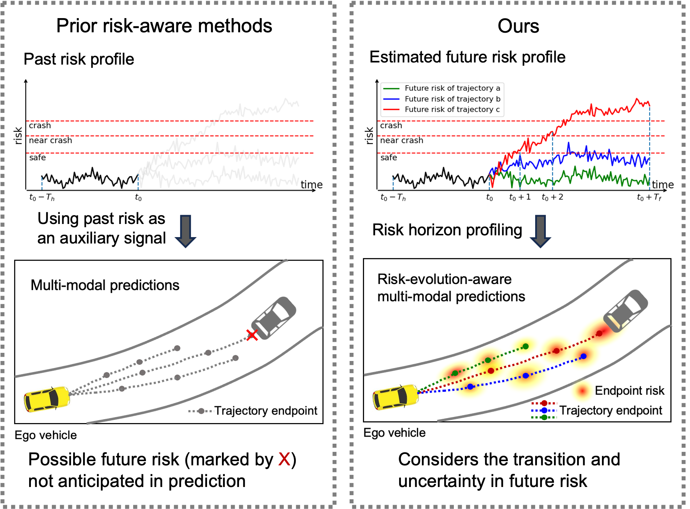

<div align="center">

<h2>From Cues to Horizons:<br>Dynamic Risk Horizon Profiling for Trajectory Prediction</h2>

<p>Xinyi Ning, Zilin Bian, Dachuan Zuo, Semiha Ergan, Kaan Ozbay</p>




</div>

The implementation of **Risk Horizon Profiling (RHP)** for vehicle trajectory prediction. RHP models the evolution of interaction risk across future horizons and uses the resulting profile to guide multimodal predictions.

Model code, pretrained checkpoints, intention templates, and small evaluation datasets are included. The bundled mini datasets support sample evaluation; full benchmark reproduction requires the complete preprocessed datasets.

## Table of Contents

- [Methods](#methods)
- [Prediction Performance](#prediction-performance)
- [Getting Started](#getting-started)
  - [Installation](#installation)
  - [Data and Checkpoints](#data-and-checkpoints)
  - [highD Data Preprocessing](#highd-data-preprocessing)
  - [Evaluation](#evaluation)
  - [Training](#training)
- [Repository Structure](#repository-structure)
- [Analysis and Baselines](#analysis-and-baselines)
- [BibTeX](#bibtex)

## Methods

**RHP** combines three components:

- **Spatial-temporal encoding:** represents observed vehicle motion and interactions.
- **Risk horizon profiling:** combines coarse endpoint predictions with ego intention templates, estimates future interaction risk, and learns which horizons matter most.
- **Risk-aware decoding:** integrates context and risk features to generate multiple future trajectories and their probabilities.


## Prediction Performance

Five-second results from Table I of the [paper](https://arxiv.org/html/2606.00857v1). Errors are in meters; lower is better.

| Dataset | minADE ↓ | minFDE ↓ | RMSE ↓ |
| :--- | ---: | ---: | ---: |
| **highD** | **0.13** | **0.38** | **0.99** |
| **SHRP2** | **0.97** | **2.36** | **7.47** |


## Getting Started

### Installation

Clone the repository and create a dedicated environment. Run the remaining commands from the repository root.

```bash
git clone https://github.com/ningzi555555/RHP.git
cd RHP
```

Install PyTorch and the dependencies:

```bash
python -m pip install --upgrade pip
python -m pip install torch==2.6.0 --index-url https://download.pytorch.org/whl/cu118
python -m pip install -r requirements.txt
python -m pip install tensorboard
```

### Data and Checkpoints

The following assets are included for sample evaluation:

| Dataset | Test data | Intention templates | Checkpoints |
| :--- | :--- | :--- | :--- |
| highD | `data/highd/test_highd_mini.mat`, `data/highd/track_highd_mini.mat` | `data/highd/ego_goal_down.mat`, `data/highd/ego_goal_up.mat` | `checkpoint/highd/` |
| SHRP2 | `data/shrp2/test_shrp_mini.mat` | `data/shrp2/ego_goal_5s.mat` | `checkpoint/shrp2/` |

Each checkpoint directory contains three matching components: `epoch12_gda.tar` (encoder), `epoch12_f.tar` (coarse endpoint predictor), and `epoch12_g.tar` (decoder). Use all three from the same dataset and epoch.


### highD Data Preprocessing

[`pre_process_highd_rhp.m`](pre_process_highd_rhp.m) converts the raw highD CSV files into the MATLAB arrays used by the loaders.

Place recordings **01–60** in `../highd-dataset-v1.0/highd-dataset-v1.0/data/`, or pass another input directory. Each recording requires three files: `<ID>_tracks.csv`, `<ID>_tracksMeta.csv`, and `<ID>_recordingMeta.csv`, with two-digit IDs such as `01`. Recordings must use the expected 25 Hz frame rate.

```matlab
rawDir = fullfile('..', 'highd-dataset-v1.0', 'highd-dataset-v1.0', 'data');
manifest = pre_process_highd_rhp(rawDir, 'highD');
```

Calling `pre_process_highd_rhp()` uses the same input and output paths. Vehicle-based split (70% / 10% / 20%).


<details>
<summary><strong>Generated files and data format</strong></summary>

All files below are written under the selected output directory using MAT v7, compatible with the existing `scipy.io.loadmat` calls.

| Output | MATLAB variable | Contents |
| :--- | :--- | :--- |
| `TrainSetHighD_<N>.mat` | `trajTr` | Training samples for each 15-recording shard; `<N>` = `15`, `30`, `45`, `60` |
| `track_HighD_<N>.mat` | `tracks` | Matching 15-row track-cell arrays, with vehicle IDs indexing columns |
| `ValSetHighD.mat`, `TestSetHighD.mat` | `traj` | Full validation and test sample arrays |
| `track_HighD_1.mat`, `track_HighD_2.mat` | `tracks` | Track-cell arrays for recordings 1–30 and 31–60; concatenate to obtain global recording indexing |
| `test_highd_mini.mat`, `track_highd_mini.mat` | `traj`, `tracks`, respectively | A deterministic subset of the test samples and all ego/neighbor tracks referenced by that subset |
| `preprocess_manifest.mat` | `manifest` | Options, per-recording counts, and target vehicle assignments in `manifest.vehicleSplits` (`1` = train, `2` = val, `3` = test) |

Each sample has **42 columns**: `(recordingId, vehicleId, frame, y, x, vy, vx, laneId, width, height, ay, ax)` followed by 30 neighbor IDs. Each nonempty track cell is **10 × T** with rows `(frame, y, x, vy, vx, laneId, width, height, ay, ax)`. Position, dimensions, velocity, and acceleration use feet-based units; IDs, frame numbers, and lane IDs are unchanged.

Sample anchors require 75 preceding and 125 following raw frames, corresponding to 3 seconds of history and 5 seconds of prediction at 25 Hz. The loader subsequently samples these tracks at 5 Hz. Up to five nearest qualifying neighbors are retained in each of six lane/longitudinal slots, for at most 30 neighbors from the same driving direction.

</details>

### Evaluation

Run evaluation from the repository root and specify the dataset with the `--dataset` argument:

```bash
# highD
python evaluate.py --dataset highd

# SHRP2
python evaluate.py --dataset shrp2
```

<details>
<summary><strong>Evaluation outputs and metric conventions</strong></summary>

| Output | Meaning |
| :--- | :--- |
| `rmse_real in meters` | Aggregate RMSE of the mode selected by minimum masked summed displacement over the full future window, followed by a per-step RMSE vector |
| `max prob rmse_real in meters` | Aggregate RMSE of the highest-probability mode, followed by a per-step RMSE vector |
| `ade in meters` | Average displacement errors over the first 1, 2, 3, 4, and 5 seconds of the selected best-displacement mode |
| `fde in meters` | Endpoint displacement errors at 1, 2, 3, 4, and 5 seconds of that same mode |


</details>

### Training

For highD, run [highD Data Preprocessing](#highd-data-preprocessing) with the default `highD/` output directory to generate the training and validation files below.

Set these values consistently in `config.py`:

| Setting | highD | SHRP2 |
| :--- | :--- | :--- |
| `args['dataset']` | `'highd'` | `'shrp2'` |
| `args['path']` | `'checkpoint/highd'` | `'checkpoint/shrp2'` |
| `args['ego_goals_path']` | `'data/highd/'` | `'data/shrp2/'` |


After completing these prerequisites, run the entry point for your configured dataset:

```bash
# highD
python train_highD.py

# SHRP2
python train_shrp2.py
```

<details>
<summary><strong>Model and training configuration</strong></summary>

| Parameter | Current value |
| :--- | :--- |
| History / prediction steps | 16 / 25, sampled at 5 Hz |
| Input features per agent | 13 |
| Encoder hidden size / attention heads | 64 / 4 |
| Intention templates / output modes | 100 / 6 |
| Horizon endpoints | 5 |
| Batch size | 128 |
| Initial learning rate | `0.0005` |
| Epochs | 20 |
| Encoder / decoder layers | highD: 1 / 1; SHRP2: 3 / 2 |
| Learning-rate decay per epoch | highD: `0.4`; SHRP2: `0.6` |


</details>

## Repository Structure

```text
RHP/
|-- config.py                       # Shared model and training settings
|-- common.py                       # Neural-network building blocks
|-- gnn_model_risk_large.py          # Spatial-temporal encoder
|-- FoePredict.py                   # Coarse endpoint predictors
|-- risk_decoder_autobot_v1_time.py  # Risk profiling, decoder, and losses
|-- pre_process_highd_rhp.m         # highD CSV preprocessing and vehicle split
|-- loader_highD.py                 # highD data loader
|-- loader_risky_time.py             # SHRP2 data loader
|-- evaluate.py                     # Checkpoint evaluation
|-- train_highD.py                  # highD training
|-- train_shrp2.py                  # SHRP2 training
|-- requirements.txt
|-- data/                           # Mini datasets, intention templates, and vision.png
|-- checkpoint/                     # Pretrained and experimental weights
```

## Analysis and Baselines

[`analyze/`](analyze/) contains risk evaluation, horizon-attention inspection, and trajectory visualization scripts. These are experiment-specific utilities; check their input paths before use.

[`baselines/`](baselines/) includes S-LSTM, CS-LSTM, WSiP, PiP, STDAN, HLTP, and Social GAN implementations. Follow their individual configurations, dependencies, and available READMEs. The root installation instructions target RHP.

## BibTeX

If you use RHP in your research, please cite:

```bibtex
@article{ning2026rhp,
  title   = {From Cues to Horizons: Dynamic Risk Horizon Profiling for Trajectory Prediction},
  author  = {Ning, Xinyi and Bian, Zilin and Zuo, Dachuan and Ergan, Semiha and Ozbay, Kaan},
  journal = {arXiv preprint arXiv:2606.00857},
  year    = {2026},
  doi     = {10.48550/arXiv.2606.00857},
  url     = {https://arxiv.org/abs/2606.00857}
}
```
